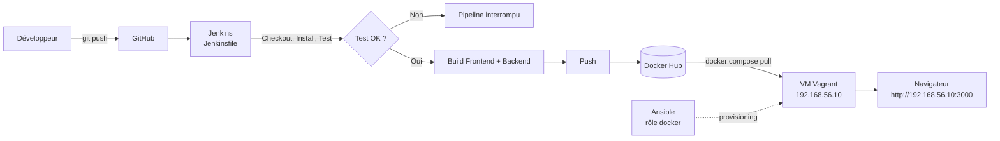
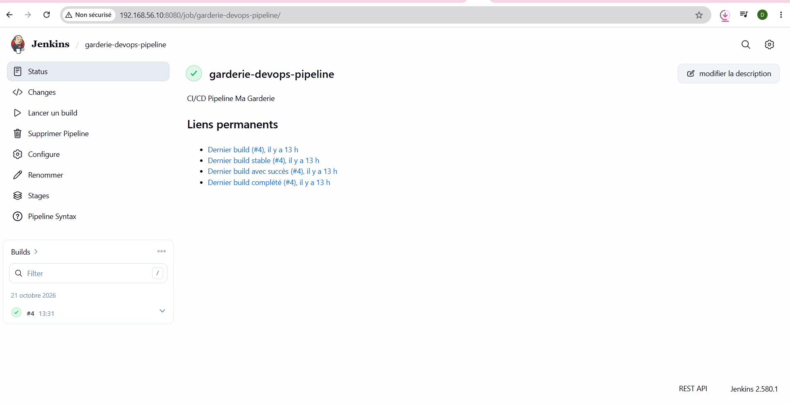
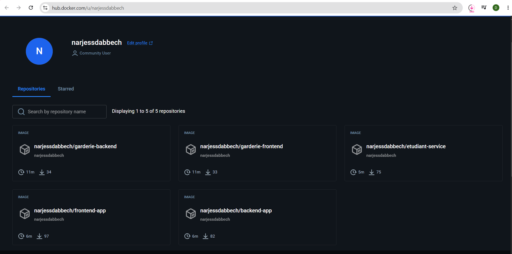
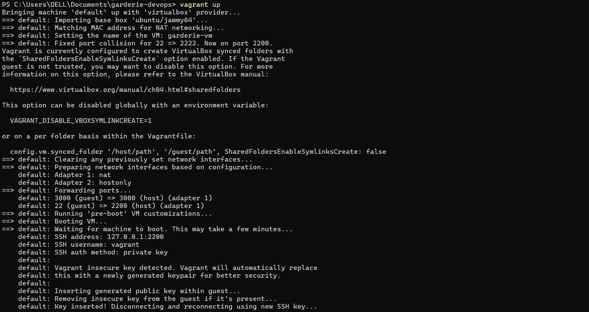
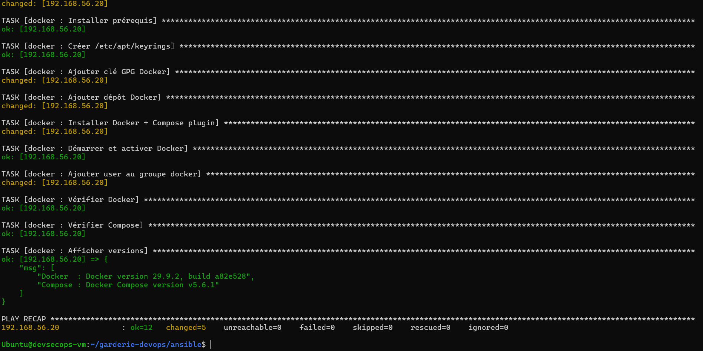
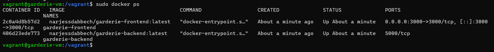
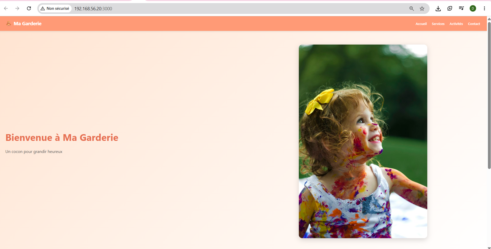

# 🧸 Ma Garderie — Projet DevOps & Cloud

> Application Web (Next.js + Express) déployée via une chaîne CI/CD complète :
> **GitHub → Jenkins → Docker Hub → Vagrant → Ansible → Docker Compose**

**Auteur** : Narjess Dabbech — Master DevOps & Cloud — 2026
**Dépôt** : https://github.com/Narjess805/garderie-devops

---

## 📑 Sommaire

1. [Présentation](#1--présentation)
2. [Technologies utilisées](#2--technologies-utilisées)
3. [Architecture](#3--architecture)
4. [Structure du projet](#4--structure-du-projet)
5. [API REST](#5--api-rest)
6. [Lancement en local](#6--lancement-en-local-docker-compose)
7. [Création et provisioning de la VM](#7--création-et-provisioning-de-la-vm)
8. [Pipeline Jenkins](#8--pipeline-jenkins)
9. [Images Docker Hub](#9--images-docker-hub)
10. [Déploiement avec Docker Compose](#10--déploiement-avec-docker-compose)
11. [Accès à l'application](#11--accès-à-lapplication)
12. [Workflow Git](#12--workflow-git)
13. [Captures d'écran](#13--captures-décran)
14. [Contact](#14--contact)

---

## 1. 🎯 Présentation

**Ma Garderie** est une landing page responsive pour une garderie d'enfants. Elle affiche dynamiquement les informations et les services récupérés depuis un backend REST.

**Composants du frontend (Next.js)** :

| Composant | Rôle |
|---|---|
| `Navbar` | Logo, nom de la garderie, menu de navigation |
| `Hero` | Image, titre de bienvenue, description |
| `Services` | Affichage des services proposés (données issues de l'API) |

**Objectifs DevOps du projet** :

- Automatiser le test, la construction et la publication des images (Jenkins)
- Créer une infrastructure reproductible (Vagrant)
- Provisionner la VM automatiquement (Ansible, rôle `docker`)
- Déployer à partir des images publiées sur Docker Hub (Docker Compose)

---

## 2. 🛠️ Technologies utilisées

| Domaine | Outil |
|---|---|
| Frontend | Next.js 14 / React 18 |
| Backend | Node.js 20 / Express |
| Tests | Jest |
| Conteneurisation | Docker, Docker Compose |
| CI/CD | Jenkins (Pipeline as Code) |
| Infrastructure | Vagrant (VirtualBox) + Ubuntu 22.04 |
| Provisioning | Ansible |
| Registry | Docker Hub |
| Versioning | Git / GitHub |

---

## 3. 🏗️ Architecture

### Chaîne CI/CD



### Architecture applicative

```
┌─────────────────────────── VM Ubuntu (192.168.56.10) ───────────────────────────┐
│                                                                                  │
│   Réseau Docker : garderie-net                                                   │
│   ┌────────────────────┐   HTTP    ┌────────────────────┐                        │
│   │ frontend (Next.js) │ ────────▶ │ backend (Express)  │                        │
│   │ port 3000          │           │ port 5000          │                        │
│   └────────────────────┘           └────────────────────┘                        │
└──────────────────────────────────────────────────────────────────────────────────┘
```

---

## 4. 📁 Structure du projet

```
garderie-devops/
├── frontend/                  # Application Next.js (+ test Jest, Dockerfile)
├── backend/                   # API Express (+ Dockerfile)
├── ansible/
│   ├── inventory.ini          # Inventaire
│   ├── site.yml               # Playbook principal
│   └── roles/
│       └── docker/            # Rôle : Docker Engine + plugin Compose
├── screenshots/               # Captures d'écran
├── Jenkinsfile                # Pipeline CI/CD
├── Vagrantfile                # VM Ubuntu
├── docker-compose.yml         # Dev (build local)
├── docker-compose.prod.yml    # Prod (images Docker Hub)
├── .npmrc                     # Configuration npm
└── README.md
```

---

## 5. 📡 API REST

| Méthode | Endpoint | Description |
|---|---|---|
| `GET` | `/api/garderie` | Informations générales (nom, slogan, adresse) |
| `GET` | `/api/services` | Liste des services proposés |
| `GET` | `/api/activites` | Liste des activités hebdomadaires |

Exemple :

```bash
curl http://192.168.56.10:5000/api/garderie
```

---

## 6. 🚀 Lancement en local (Docker Compose)

```bash
git clone https://github.com/Narjess805/garderie-devops.git
cd garderie-devops
docker compose up --build -d
```

- Frontend : http://localhost:3000
- Backend : http://localhost:5000/api/garderie

Arrêt : `docker compose down`

---

## 7. 🖥️ Création et provisioning de la VM

### Caractéristiques de la VM

| Paramètre | Valeur |
|---|---|
| Système | Ubuntu Server 22.04 |
| RAM | 2 Go |
| CPU | 2 vCPU |
| Réseau | Privé, IP fixe `192.168.56.10` |

### Commandes

```bash
vagrant up          # Crée la VM et exécute le playbook Ansible
vagrant ssh         # Connexion SSH à la VM
vagrant provision   # Relancer uniquement le provisioning
vagrant destroy -f  # Supprimer la VM
```

### Provisioning Ansible

Le `Vagrantfile` appelle automatiquement `ansible/site.yml`, qui applique le rôle **`docker`** :

1. Installation de Docker Engine
2. Installation du plugin Docker Compose
3. Démarrage et activation du service Docker
4. Ajout de l'utilisateur de déploiement (`vagrant`) au groupe `docker`

Vérification dans la VM :

```bash
docker --version
docker compose version
systemctl status docker
```

---

## 8. ⚙️ Pipeline Jenkins

### Configuration

1. Ajouter les identifiants Docker Hub : *Manage Jenkins → Credentials* → type **Username with password**, ID = `dockerhub-credentials`
2. Créer un item de type **Pipeline** → *Pipeline script from SCM*
3. Paramètres :
   - **SCM** : Git
   - **Repository URL** : `https://github.com/Narjess805/garderie-devops.git`
   - **Branch** : `*/main`
   - **Script Path** : `Jenkinsfile`
4. Cliquer sur **Build Now**

### Étapes du pipeline

| # | Stage | Description |
|---|---|---|
| 1 | Checkout | Récupération du code depuis GitHub |
| 2 | Install | Installation des dépendances (`npm install`) |
| 3 | Test | Exécution du test frontend (`npm test -- --ci`) |
| 4 | Build Frontend | Construction de l'image frontend |
| 5 | Build Backend | Construction de l'image backend |
| 6 | Push Frontend | Publication sur Docker Hub |
| 7 | Push Backend | Publication sur Docker Hub |

> 🔒 Si le test échoue, le pipeline s'interrompt : aucune image n'est construite ni publiée.
> Les identifiants Docker Hub sont gérés exclusivement par **Jenkins Credentials** (jamais en clair dans le dépôt).

---

## 9. 🐳 Images Docker Hub

| Service | Image | Lien |
|---|---|---|
| Frontend | `narjess805/garderie-frontend` | https://hub.docker.com/r/narjess805/garderie-frontend |
| Backend | `narjess805/garderie-backend` | https://hub.docker.com/r/narjess805/garderie-backend |

---

## 10. 🚢 Déploiement avec Docker Compose

Le déploiement utilise **uniquement les images publiées sur Docker Hub** (aucune reconstruction locale).

```bash
vagrant ssh
cd /home/vagrant/garderie-devops
export DOCKERHUB_USER=narjess805
docker compose -f docker-compose.prod.yml up -d
```

Vérification :

```bash
docker compose -f docker-compose.prod.yml ps
curl http://localhost:5000/api/garderie
curl http://localhost:5000/api/services
curl http://localhost:5000/api/activites
```

---

## 11. 🌐 Accès à l'application

| Ressource | URL |
|---|---|
| Application | http://192.168.56.10:3000 |
| API garderie | http://192.168.56.10:5000/api/garderie |
| API services | http://192.168.56.10:5000/api/services |
| API activités | http://192.168.56.10:5000/api/activites |

L'application est accessible depuis toute machine du même réseau via l'adresse IP de la VM.

---

## 12. 🌿 Workflow Git

| Branche | Contenu | Fusion |
|---|---|---|
| `main` | Branche principale | — |
| `feature/vagrant` | Vagrantfile | → `main` |
| `feature/ansible` | Inventaire, playbook, rôle `docker` | → `main` |
| `feature/deployment` | `docker-compose.prod.yml` | → `main` |
| `docs/readme` | README et captures d'écran | → `main` |

---

## 13. 📸 Captures d'écran

### Pipeline Jenkins exécuté avec succès


### Images publiées sur Docker Hub


### VM démarrée avec Vagrant


### Exécution réussie du playbook Ansible


### Conteneurs Docker en cours d'exécution


### Application accessible dans le navigateur (autre machine)


---

## 14. 👤 Contact

- **Responsable** : Narjess Dabbech
- **Téléphone** : 27 003 391
- **Email** : narjessdabbech3@gmail.com
- **Adresse** : Sousse, Tunisie
